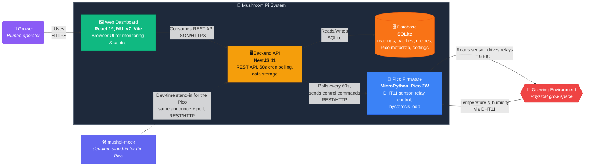

<p align="center">
  
</p>

# 🍄 Mushroom Pi 🍓

Automated mushroom-growing control, built as a three-tier open-source system. A **Raspberry Pi Pico 2W** reads a DHT11 temperature/humidity sensor and drives humidifier, fan, and heater relays through a hysteresis control loop; a **NestJS backend** polls each unit every 60 seconds and stores readings in SQLite; and a **React dashboard** displays and controls everything. The server and client ship together as one container image that serves both the API and the UI on port 3000, targeting a Raspberry Pi 3 (1GB).




A **grower** interacts through the web dashboard to monitor conditions, set temperature/humidity targets, and manage cultivation batches. The **Pico firmware** reads the environment and runs the control loop locally; the **backend** polls it every 60 seconds, stores history in SQLite, and proxies control commands back to the unit. The **dashboard** consumes the backend's OpenAPI spec through an auto-generated client. Multiple Pico 2W units can be deployed, each controlling its own grow space. During development, `mushpi-mock` (dotted) stands in for a real Pico — the server can't tell the difference.

| Tier | Language | Framework | Key libraries |
|------|----------|-----------|---------------|
| Pico firmware | MicroPython | — | Microdot (web), urequests (HTTP client) |
| Backend | TypeScript | NestJS 11 | TypeORM, SQLite, Swagger/OpenAPI, @nestjs/schedule |
| Dashboard | TypeScript | React 19 | MUI v7, TanStack Query v5, Recharts v3, React Router v7 |
| Mock | Python | FastAPI | uv |

## Repositories

| Repo | What it is |
|------|------------|
| [`mushpi-grow`](https://github.com/mushroom-pi/mushpi-grow) | MicroPython firmware for the Pico 2W — DHT11 sensor reading, relay control, hysteresis loop, REST API on port 5000 |
| [`mushpi-server`](https://github.com/mushroom-pi/mushpi-server) | NestJS 11 backend — 60s cron polling, SQLite storage, control proxying, batches/recipes/images, OpenAPI spec |
| [`mushpi-client`](https://github.com/mushroom-pi/mushpi-client) | React 19 dashboard — auto-generated OpenAPI client, MUI v7, TanStack Query, Recharts |
| [`mushpi-mock`](https://github.com/mushroom-pi/mushpi-mock) | FastAPI mock Pico unit service — mirrors `mushpi-grow`'s REST API for demos and testing without hardware |
| [`mushpi-docs`](https://github.com/mushroom-pi/mushpi-docs) | The published Mintlify documentation site — MDX pages + `docs.json` navigation; the live documentation the site migration is moving into it |
| [`mushpi-ops`](https://github.com/mushroom-pi/mushpi-ops) | The release/self-hosting entry point — Dockerfile, compose, CI publish to GHCR, the release manifest |
| [`mushpi-orchestration`](https://github.com/mushroom-pi/mushpi-orchestration) | The AI orchestration workspace — OpenCode agent definitions, the orchestration workflow skill, cross-repo context |
| [`.github`](https://github.com/mushroom-pi/.github) | This organization profile |

## Run it

The release repo is the self-hosting entry point — no build step, no agent tooling. See `mushpi-ops/README.md` to get started; `mushpi-ops/DEPLOYMENT.md` covers SD-card provisioning, first boot, Pico unit setup, the update workflow, backups, and Tailscale remote access. The published image is `ghcr.io/mushroom-pi/mushpi`.

## Work on it

Every capability lives in its own repository, so clone the one you care about and work in it directly — each repo's `README.md` covers building, testing and running it:

```bash
git clone https://github.com/mushroom-pi/mushpi-grow.git
git clone https://github.com/mushroom-pi/mushpi-server.git
git clone https://github.com/mushroom-pi/mushpi-client.git
git clone https://github.com/mushroom-pi/mushpi-mock.git
```

The release repo — `git clone https://github.com/mushroom-pi/mushpi-ops.git` — is needed only to build the image or cut a release.

### Optional: the AI orchestration workspace

**No AI tooling is required to contribute.** If you do want the orchestrated workflow, [`mushpi-orchestration`](https://github.com/mushroom-pi/mushpi-orchestration) is the workspace that arranges the repositories as siblings and drives the OpenCode agent roles behind a single `mushpi-orchestrator`. It reflects one person's OpenCode setup — agent definitions, model subscriptions and skills — rather than a packaged product, so treat it as an optional workflow to adapt, not a prerequisite. Working directly in a single repository is a first-class path.

## Where to go next

- `mushpi-docs/` — the published documentation site: architecture, hardware reference and the grower guide, as pages are migrated into it.
- `mushpi-ops/README.md` — run it. `mushpi-ops/DEPLOYMENT.md` — deploy it.
- [`mushpi-orchestration`](https://github.com/mushroom-pi/mushpi-orchestration) — the optional AI orchestration workspace; its `README.md` covers how the machinery is configured and driven.

## Contact

Questions, bug reports and contributions are welcome — open an issue on the relevant repository, or email [mushpi@amda.dev](mailto:mushpi@amda.dev).
